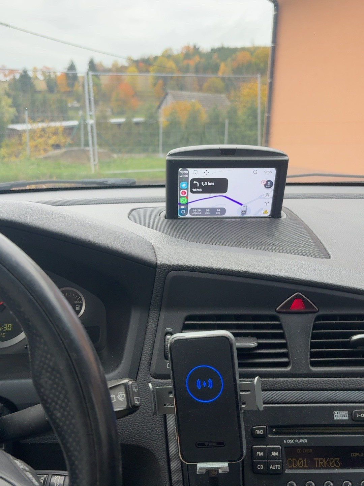
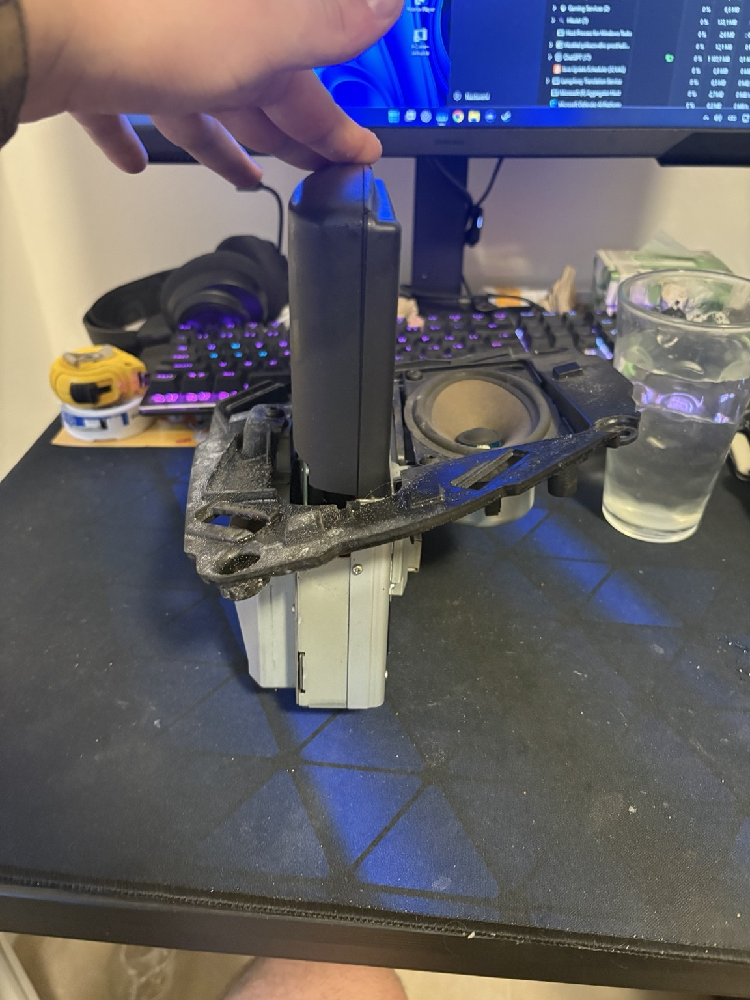
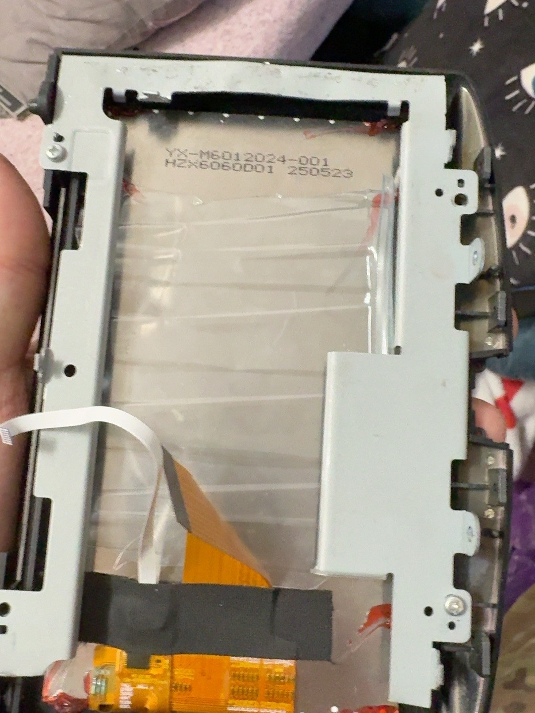

# Volvo P2 RTI Wireless CarPlay Retrofit

**Modern navigation inside the original pop-up RTI housing.**

A DIY transplant of a **VENBES 6-inch portable wireless CarPlay unit** into the OEM motorized RTI assembly of a **Volvo V70 II (P2 facelift)**, with audio through a **WEFA MELBUS Bluetooth adapter and the factory HU-850**.

> **Work in progress:** CarPlay and Waze are working. The OEM mechanism and electronics have been retained, but automatic raising and lowering are still pending a Y-splitter and reconnection of the original RTI power supply.

## Current status

The following reflects the owner's reported build status as of **31 October 2026**. It is not an independently validated installation guide.

| Feature | Status |
| --- | --- |
| Wireless CarPlay | Working |
| Waze through CarPlay | Working |
| OEM RTI mechanism and electronics | Retained |
| Automatic motorized operation | Pending Y-splitter and original RTI power reconnection |
| Audio through HU-850 | Uses WEFA MELBUS Bluetooth audio |
| Microphone / Siri | Likely working; explicit end-to-end verification still needed |
| Power observation | Switched power measured on a purple wire in this vehicle |
| Original blue RTI connector | Currently disconnected |
| Connector pinout | Not verified; no pin-to-pin wiring instructions published |

## The idea

Keep the original RTI location and motorized hardware while using the VENBES unit for modern wireless CarPlay. The original HU-850 remains the audio head unit, with WEFA providing the MELBUS Bluetooth audio route.

This repository records one owner's build. Compatibility with other P2 models, model years, RTI revisions or similarly named portable displays has not been established.

## System overview

```text
Display:  iPhone -- wireless CarPlay --> VENBES 6-inch unit in OEM RTI housing
Audio:    Bluetooth audio --> WEFA MELBUS adapter --> factory HU-850
Motion:   retained OEM RTI mechanism + electronics
          original RTI power reconnection + Y-splitter: pending
```

This is a functional overview, not a wiring diagram. The exact Bluetooth pairing sequence and complete audio routing still need to be recorded.

## Hardware used

| Item | Role / known detail |
| --- | --- |
| Volvo V70 II, P2 facelift | Host vehicle; exact model year not documented here |
| Original motorized RTI assembly | Housing, mechanism and OEM electronics retained |
| VENBES 6-inch portable wireless CarPlay unit | Donor display / CarPlay hardware; exact model revision to be recorded |
| Volvo HU-850 | Factory head unit |
| WEFA MELBUS Bluetooth adapter | Bluetooth audio through the factory system |
| Y-splitter | Pending item for the planned power reconnection; exact type and wiring not yet documented |

Exact part numbers, dimensions and hardware revisions remain to be documented.

## Donor display — VENBES 6-inch

The donor for this build is a **VENBES 6-inch portable wireless CarPlay unit**, purchased through Temu. Its display and CarPlay hardware are used inside the original Volvo RTI housing.

| Detail | This build |
| --- | --- |
| Brand / screen size | VENBES / 6-inch, as identified by the owner |
| Functions in use | Wireless Apple CarPlay and Waze |
| Installation | Transplanted into the OEM RTI housing |
| Audio | WEFA MELBUS Bluetooth adapter through the HU-850 |

**[View the purchased donor unit on Temu](https://www.temu.com/goods.html?goods_id=607568940352056&sku_id=116616952072036)**

Listing availability, variants and specifications may change; the seller's current page has not been independently verified. The exact hardware revision still needs to be recorded.




*Owner's build photo showing the installed display with navigation running. A verified seller product image can be added later.*

## Build documentation

- [Build overview and missing assembly details](docs/build.md)
- [Power, audio and wiring observations](docs/wiring-and-audio.md)
- [Assembly photo index](assets/photos/README.md)

## Power and wiring: read first

A purple wire was measured as carrying switched power in this particular vehicle. **Wire colour alone does not identify a circuit or prove that it can safely supply the retrofit.** No connector cavity number, voltage trace, current capacity, fuse selection or complete pinout has been verified in this documentation.

The original blue connector is disconnected. Retaining the OEM electronics does not establish that the motorized assembly currently works. The planned Y-splitter and original RTI power reconnection remain untested here.

Before reproducing any power connection, identify the circuit from documentation for the exact vehicle and verify voltage, polarity, load capacity and protection. Confirm the donor unit's required input voltage and any adapter requirements from its own label or documentation. Do not assume the bare electronics accept vehicle supply voltage.

## Photos

The gallery contains 17 photographs selected by the owner, covering the original RTI, display assembly details, vehicle connectors and installed display.






[View the complete build gallery](assets/photos/README.md). A raised display in a still photograph does not demonstrate automatic raising or lowering.

## Next milestone

Restore the original RTI power connection using the planned Y-splitter, then document whether the retained mechanism raises and lowers correctly. After that, record repeatable ignition-cycle, audio and Siri tests.

This is a community DIY project, unaffiliated with Volvo, Apple, VENBES or WEFA.
