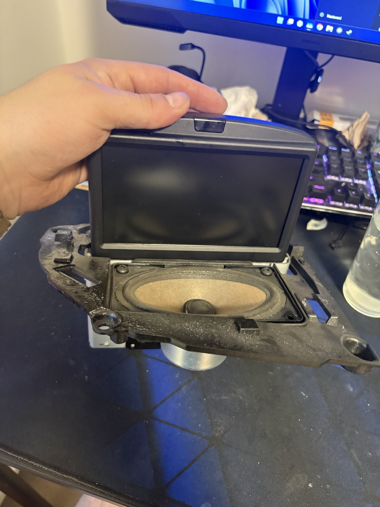
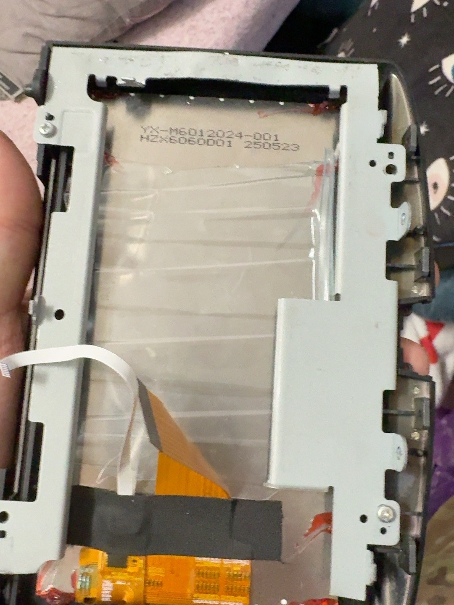
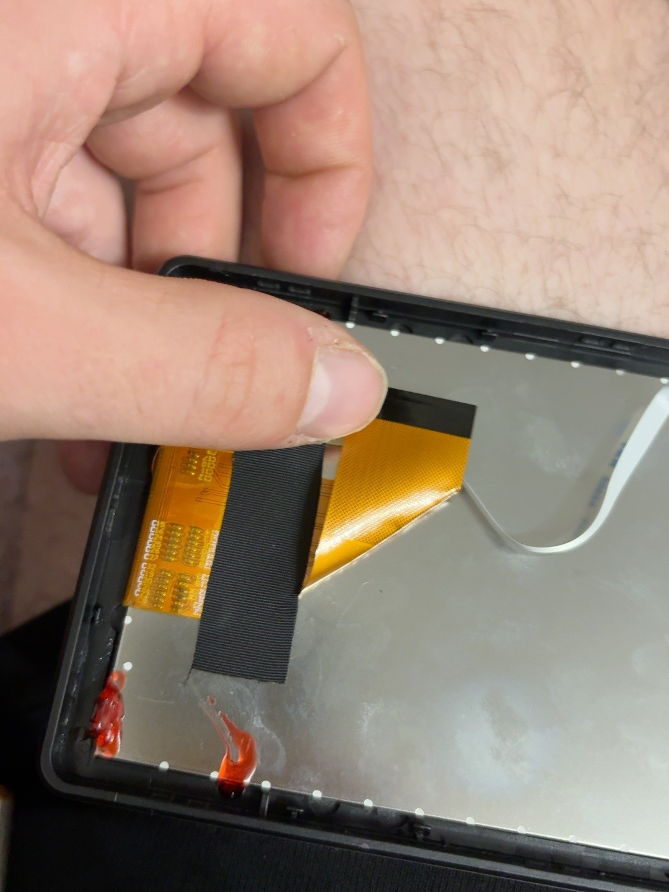
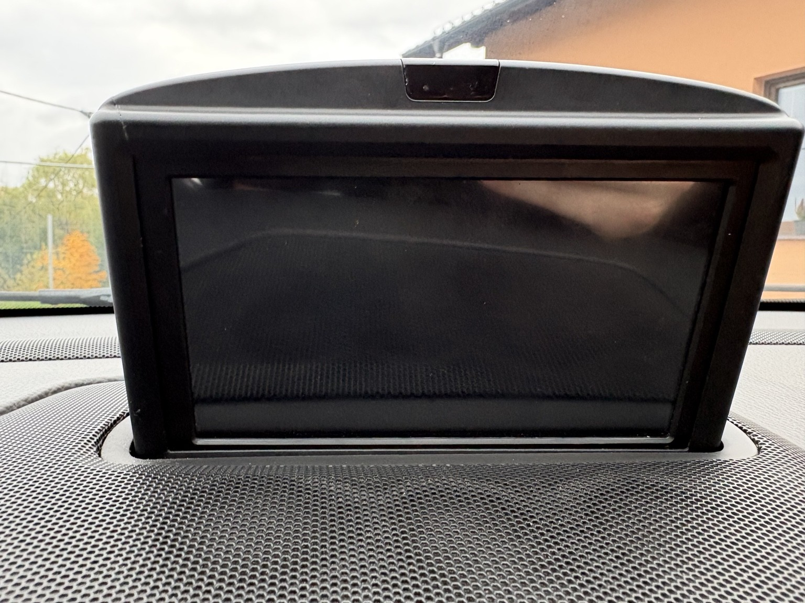

# Build overview

[Back to README](../README.md)

## What this build establishes

The owner reports a VENBES 6-inch portable wireless CarPlay transplant into the OEM RTI assembly of a Volvo V70 II P2 facelift. CarPlay and Waze work. The original motorized mechanism and OEM electronics have been retained.

Automatic raising and lowering have not yet been demonstrated in the documented configuration. The original blue RTI connector is disconnected, and a Y-splitter plus original RTI power reconnection are pending.

## Assembly details still needed

This is a build record, not a complete teardown or fabrication tutorial. The selected photos show the original mechanism, display enclosure details, ribbon cable, vehicle connectors and the installed display. They do not establish:

- Exact vehicle year, RTI part number or VENBES model revision.
- Which donor enclosure parts were removed or modified.
- Mounting method, bracket dimensions, fasteners or clearances.
- Screen alignment, cable routing, insulation and strain relief.
- Full travel clearance with the transplanted hardware fitted.
- Final power adapter and Y-splitter specifications.

These details should be added from the actual build and verified photos before publishing step-by-step assembly instructions. No CAD files, cut templates or wiring schematics are available yet.

## Suggested documentation sequence

1. Photograph the installed display with CarPlay / Waze visible.
2. Record labels and part numbers for the donor unit and RTI assembly.
3. Photograph the internal arrangement, retained electronics and mounting points.
4. Show the power connections, original blue connector and planned splitter.
5. After reconnection, record full raising and lowering with cable clearance visible.
6. Add dimensions and repeatable assembly instructions only after checking them against the hardware.

For electrical observations, see [wiring and audio](wiring-and-audio.md). For completion criteria, see [verification](verification.md).

## Illustrated build record

See the [complete photo gallery](../assets/photos/README.md) for the owner-selected views. Removed photographs of outdated donor hardware are excluded. The sequence is an archive of the build, not a verified disassembly procedure.

